# HelpDesk Enterprise 2026

> **Hệ thống Quản lý Yêu cầu Hỗ trợ & Xử lý Sự cố Dịch vụ Toàn diện (IT Service Desk & Incident Management System)**  
> Đề tài Đồ án Chuyên ngành Công nghệ Thông tin — Xây dựng theo tiêu chuẩn Quản lý Dịch vụ Công nghệ Thông tin Quốc tế **ITIL v4** & **ISO/IEC 20000**.

[](https://helpdesk.dshinee.site)
[](https://spring.io/projects/spring-boot)
[](https://react.dev/)
[](https://www.postgresql.org/)
[](https://redis.io/)
[](https://www.docker.com/)
[](#giấy-phép--bản-quyền)

---

## 📑 MỤC LỤC CHI TIẾT
1. [Tổng Quan Đề Tài & Bài Toán Thực Tế](#1-tổng-quan-đề-tài--bài-toán-thực-tế)
2. [Thông Tin Triển Khai Thực Tế (Live Production)](#2-thông-tin-triển-khai-thực-tế-live-production)
3. [Kiến Trúc Hệ Thống (System Architecture)](#3-kiến-trúc-hệ-thống-system-architecture)
4. [Biểu Đồ Phân Rã Chức Năng (Functional Decomposition Diagram)](#4-biểu-đồ-phân-rã-chức-năng-functional-decomposition-diagram)
5. [Đặc Tả 10 Phân Hệ Chức Năng Cốt Lõi (YC1 - YC10)](#5-đặc-tả-10-phân-hệ-chức-năng-cốt-lõi-yc1---yc10)
5. [Thiết Kế Cơ Sở Dữ Liệu (14 Bảng Thực Thể JPA)](#5-thiết-kế-cơ-sở-dữ-liệu-14-bảng-thực-thể-jpa)
6. [Hệ Thống RESTful API & WebSocket](#6-hệ-thống-restful-api--websocket)
7. [Chính Sách Cam Kết Dịch Vụ (SLA) & Cơ Chế Leo Thang](#7-chính-sách-cam-kết-dịch-vụ-sla--cơ-chế-leo-thang)
8. [Phân Hệ Giao Diện Kép (Dual-Portal UI/UX)](#8-phân-hệ-giao-diện-kép-dual-portal-uiux)
9. [Trợ Lý Kỹ Thuật Thông Minh (AI Support Assistant)](#9-trợ-lý-kỹ-thuật-thông-minh-ai-support-assistant)
10. [Mô Hình Bảo Mật & Phân Quyền Đa Tầng (Strict RBAC)](#10-mô-hình-bảo-mật--phân-quyền-đa-tầng-strict-rbac)
11. [Cấu Trúc Thư Mục Dự Án (Repository Tree)](#11-cấu-trúc-thư-mục-dự-án-repository-tree)
12. [Hướng Dẫn Cài Đặt & Triển Khai (Deployment Guide)](#12-hướng-dẫn-cài-đặt--triển-khai-deployment-guide)
13. [Tài Khoản Kiểm Thử Nghiệp Vụ (Demo Credentials)](#13-tài-khoản-kiểm-thử-nghiệp-vụ-demo-credentials)
14. [Chính Sách Cập Nhật & Nhật Ký Phiên Bản (Changelog)](#14-chính-sách-cập-nhật--nhật-ký-phiên-bản-changelog)

---

## 1. Tổng Quan Đề Tài & Bài Toán Thực Tế

Trong môi trường doanh nghiệp hiện đại, việc vận hành dịch vụ công nghệ thông tin (IT HelpDesk) thường xuyên đối mặt với các thách thức lớn:
- **Tiếp nhận phân tán**: Yêu cầu hỗ trợ gửi rải rác qua Zalo, tin nhắn cá nhân, điện thoại hoặc Excel, dẫn đến tình trạng thất lạc yêu cầu và không kiểm soát được khối lượng công việc.
- **Thiếu cam kết chất lượng (SLA)**: Không đo lường được thời gian phản hồi (MTTA) và thời gian giải quyết sự cố (MTTR), các sự cố khẩn cấp (sập mạng, hỏng máy in hóa đơn) không được ưu tiên xử lý tức thì.
- **Thiếu cơ sở tri thức (Knowledge Base)**: Kỹ thuật viên phải liên tục trả lời các câu hỏi lặp đi lặp lại (cài máy in, đổi pass wifi, lỗi outlook) thay vì để người dùng tự xử lý.
- **Đánh giá thiếu minh bạch**: Quản lý không có số liệu định lượng về năng suất của kỹ thuật viên cũng như mức độ hài lòng thực tế của cán bộ nhân viên.

**HelpDesk Enterprise** được xây dựng nhằm giải quyết triệt để các bài toán trên bằng cách tự động hóa và chuẩn hóa toàn bộ quy trình tiếp nhận, điều phối, xử lý và giám sát sự cố theo khung tiêu chuẩn **ITIL v4**.

---

## 2. Thông Tin Triển Khai Thực Tế (Live Production)

Hệ thống đã được đóng gói container và triển khai chạy thực tế trên máy chủ Internet:
* **Tên miền chính thức**: [`https://helpdesk.dshinee.site`](https://helpdesk.dshinee.site)
* **Máy chủ quản trị**: Linux VPS tích hợp bảng điều khiển **aaPanel**
* **Cơ chế Gateway**: Nginx Reverse Proxy tiếp nhận HTTPS port 443 và phân luồng:
  - `location /`: Forward sang container Frontend React (cổng `3000`).
  - `location /api`: Forward sang container Backend Spring Boot (cổng `8080`).
  - `location /ws`: Forward giao thức WebSocket STOMP hỗ trợ cập nhật thời gian thực.
* **Chứng chỉ an ninh**: Tích hợp SSL/TLS (Let's Encrypt / Cloudflare Universal SSL) mã hóa chuẩn AES-256.

---

## 3. Kiến Trúc Hệ Thống (System Architecture)

Hệ thống được thiết kế theo mô hình **3-Tier Micro-Architecture** độc lập:

```
[ Người Dùng / Khách Hàng ]        [ Kỹ Thuật Viên / Quản Trị ]
             │                                   │
             ▼                                   ▼
   [ Customer Portal ]                 [ Admin & Staff Console ]
   (React 18 + Tailwind)               (React 18 + Recharts)
             │                                   │
             └─────────────────┬─────────────────┘
                               │ (HTTPS / WSS)
                               ▼
                   [ Nginx Reverse Proxy Gateway ]
                   (aaPanel Host Manager - Port 443)
                               │
                ┌──────────────┴──────────────┐
                │ /                           │ /api, /ws
                ▼                             ▼
       [ helpdesk-frontend ]         [ helpdesk-backend ]
       (Nginx Alpine - Port 3000)   (Spring Boot 3 - Port 8080)
                                              │
                      ┌───────────────────────┴───────────────────────┐
                      ▼                                               ▼
             [ helpdesk-postgres ]                           [ helpdesk-redis ]
          (PostgreSQL 15 - Port 5432)                     (Redis 7 - Port 6379)
          - Lưu trữ thực thể quan hệ                      - Cache token & session
          - Flyway Schema Migrations                      - Rate Limiting request
```

---

## 4. Biểu Đồ Phân Rã Chức Năng (Functional Decomposition Diagram)

Hệ thống được chuẩn hóa phân rã thành **4 Phân hệ cấp cao**, chia nhánh thành các khối chức năng cụ thể và luồng nghiệp vụ chi tiết:

```mermaid
graph TD
    Root["HỆ THỐNG HELPDESK ENTERPRISE"]

    Root --> M1["1. PHÂN HỆ QUẢN TRỊ & HỆ THỐNG"]
    Root --> M2["2. PHÂN HỆ VẬN HÀNH & XỬ LÝ (ITSM)"]
    Root --> M3["3. PHÂN HỆ CỔNG TỰ PHỤC VỤ (PORTAL)"]
    Root --> M4["4. PHÂN HỆ GIÁM SÁT & BÁO CÁO (BI)"]

    %% Cấp 2 của Phân hệ 1
    M1 --> M1_1["1.1. Xác thực & Kiểm soát truy cập"]
    M1 --> M1_2["1.2. Quản lý Tổ chức & Người dùng"]
    M1 --> M1_3["1.3. Cấu hình Danh mục & Độ ưu tiên"]
    M1 --> M1_4["1.4. Thiết lập Chính sách SLA"]

    M1_1 --> M1_1_A["Đăng nhập/Đăng xuất JWT"]
    M1_1 --> M1_1_B["Phân quyền 4 vai trò (RBAC)"]
    M1_1 --> M1_1_C["Kiểm soát xét duyệt đăng ký"]

    M1_2 --> M1_2_A["Quản lý cơ cấu Phòng ban"]
    M1_2 --> M1_2_B["Quản lý danh sách tài khoản"]
    M1_2 --> M1_2_C["Hồ sơ kỹ thuật & Phân tải"]

    M1_3 --> M1_3_A["Cây danh mục sự cố đa cấp"]
    M1_3 --> M1_3_B["Gán phòng ban phụ trách"]
    M1_3 --> M1_3_C["Cấu hình trọng số ưu tiên"]

    M1_4 --> M1_4_A["Ma trận SLA phản hồi (MTTA)"]
    M1_4 --> M1_4_B["Ma trận SLA giải quyết (MTTR)"]
    M1_4 --> M1_4_C["Quy tắc tự động leo thang"]

    %% Cấp 2 của Phân hệ 2
    M2 --> M2_1["2.1. Tiếp nhận & Điều phối"]
    M2 --> M2_2["2.2. Xử lý Kỹ thuật & Vòng đời"]
    M2 --> M2_3["2.3. Tương tác & Nhật ký"]

    M2_1 --> M2_1_A["Tự động sinh mã chuẩn ITIL"]
    M2_1 --> M2_1_B["Điều phối thủ công & Tự nhận (Claim)"]

    M2_2 --> M2_2_A["Luồng chuyển trạng thái 6 bước ITIL"]
    M2_2 --> M2_2_B["Cơ chế tạm dừng & kích hoạt lại SLA"]
    M2_2 --> M2_2_C["Bắt buộc ghi nhận Nguyên nhân & Giải pháp"]

    M2_3 --> M2_3_A["Bình luận công khai & Ghi chú nội bộ"]
    M2_3 --> M2_3_B["Đính kèm đa tệp tin & Nhật ký Audit Log"]

    %% Cấp 2 của Phân hệ 3
    M3 --> M3_1["3.1. Cổng Khách Hàng (Customer Portal)"]
    M3 --> M3_2["3.2. Quản lý Yêu Cầu Cá Nhân"]
    M3 --> M3_3["3.3. Cơ Sở Tri Thức (Knowledge Base)"]

    M3_1 --> M3_1_A["Bảng điều khiển cá nhân & Form gửi yêu cầu"]
    M3_1 --> M3_1_B["Khảo sát hài lòng CSAT 1-5 sao"]

    M3_2 --> M3_2_A["Cách ly dữ liệu (Chỉ xem phiếu của mình)"]
    M3_2 --> M3_2_B["Theo dõi SLA & Yêu cầu Mở lại/Hủy phiếu"]

    M3_3 --> M3_3_A["Tìm kiếm bài viết hướng dẫn xử lý (FAQ)"]
    M3_3 --> M3_3_B["Đánh giá độ hữu ích bài viết"]

    %% Cấp 2 của Phân hệ 4
    M4 --> M4_1["4.1. Bảng Thông Tin Trực Quan (Dashboard)"]
    M4 --> M4_2["4.2. Báo Cáo Hiệu Suất (KPI & CSAT)"]
    M4 --> M4_3["4.3. Giám Sát Cảnh Báo SLA"]

    M4_1 --> M4_1_A["Thống kê tổng hợp thời gian thực"]
    M4_1 --> M4_1_B["Biểu đồ phân bổ trạng thái & phòng ban"]

    M4_2 --> M4_2_A["Đo lường năng suất kỹ thuật viên"]
    M4_2 --> M4_2_B["Xuất báo cáo định dạng Excel/PDF"]

    M4_3 --> M4_3_A["Đồng hồ đếm ngược vi phạm hạn chót"]
    M4_3 --> M4_3_B["Tự động chuyển cấp khi quá hạn xử lý"]
```



> Chi tiết đặc tả phân rã cấu trúc và ma trận quan hệ Use Case được lưu trữ tại tài liệu: [docs/functional_decomposition.md](file:///c:/HelpDesk/docs/functional_decomposition.md).

---

## 5. Đặc Tả 10 Phân Hệ Chức Năng Cốt Lõi (YC1 - YC10)

Tuân thủ nghiêm ngặt góp ý của Giảng viên hướng dẫn: *"Gắn các yêu cầu cùng nhóm vào một nội dung nghiệp vụ hoàn chỉnh"*, hệ thống được quy hoạch thành 10 nhóm chức năng:

* **YC1: Quản lý Xác thực & Phân quyền (Authentication & Authorization)**:
  - Đăng nhập JWT không trạng thái, cấp phát access token và refresh token.
  - Đăng ký tài khoản người dùng gắn liền với phòng ban công tác.
  - Đổi mật khẩu, cơ chế tự động khóa tài khoản sau 5 lần đăng nhập thất bại.
* **YC2: Quản lý Người dùng & Cơ cấu Phòng ban (Users & Departments)**:
  - Phân cấp 4 vai trò: `CUSTOMER`, `AGENT`, `MANAGER`, `ADMIN`.
  - Cấu hình hồ sơ kỹ thuật viên (`AgentProfile`): Kỹ năng chuyên môn, hạn mức nhận ticket đồng thời (`max_concurrent_tickets`), trạng thái sẵn sàng trực (`is_available`).
* **YC3: Quản lý Danh mục Sự cố & Mức độ Ưu tiên (Categories & Priorities)**:
  - Danh mục sự cố đa cấp (Phần cứng, Mạng & Kết nối, Phần mềm, Tài khoản).
  - Bảng ưu tiên (`LOW`, `MEDIUM`, `HIGH`, `URGENT`) với trọng số xử lý và mã màu trực quan.
* **YC4: Quản lý Chính sách Cam kết Dịch vụ (SLA Policies)**:
  - Ma trận SLA thiết lập thời hạn phản hồi đầu tiên (`response_time_minutes`) và thời hạn giải quyết dứt điểm (`resolution_time_minutes`).
  - Bộ đếm thời gian thực tự động tính toán deadline ngay khi ticket được khởi tạo.
* **YC5: Tiếp nhận & Điều phối Phiếu Yêu cầu (Ticket Intake & Assignment)**:
  - Tự động sinh mã phiếu duy nhất dạng `TK-YYYYMMDD-XXXX`.
  - Cơ chế tự nhận việc (Agent Claim) và cơ chế điều phối chủ động từ Quản lý (Dispatcher Reassign).
* **YC6: Vòng đời Xử lý & Lịch sử Phiếu (Ticket Lifecycle & Audit Trail)**:
  - Máy trạng thái chuẩn: `NEW` $\rightarrow$ `ASSIGNED` $\rightarrow$ `IN_PROGRESS` $\leftrightarrow$ `PENDING` $\rightarrow$ `RESOLVED` $\rightarrow$ `CLOSED`.
  - Tự động ghi vết kiểm toán toàn diện (`ticket_history`) mỗi khi có sự thay đổi trạng thái, người phụ trách hoặc mức độ ưu tiên.
* **YC7: Trao đổi Bình luận & Tệp đính kèm (Comments & Attachments)**:
  - Hỗ trợ 2 chế độ bình luận: Bình luận công khai (khách hàng nhìn thấy) và Ghi chú nội bộ (`is_internal = true` - chỉ đội kỹ thuật trao đổi riêng).
  - Tải lên hình ảnh chụp lỗi màn hình, file log, tài liệu hướng dẫn (giới hạn dung lượng và kiểm tra MIME type an toàn).
* **YC8: Giám sát Vi phạm SLA & Tự động Leo thang (SLA Monitoring & Escalation)**:
  - Bộ quét nền tự động kiểm tra định kỳ các phiếu sắp hoặc đã vượt quá thời gian cam kết.
  - Kích hoạt quy tắc leo thang: Tự động đổi màu cảnh báo đỏ, gửi thông báo khẩn cấp và chuyển tiếp phiếu lên cấp Quản lý.
* **YC9: Khảo sát Hài lòng Khách hàng (CSAT Feedback)**:
  - Khách hàng đánh giá chất lượng từ 1 đến 5 sao và ghi nhận xét sau khi sự cố hoàn thành.
  - Tự động tính điểm đánh giá trung bình vào hồ sơ năng lực của Kỹ thuật viên.
* **YC10: Cơ sở Tri thức (Knowledge Base) & Báo cáo Đo lường (Reports & KPIs)**:
  - Kho bài viết hướng dẫn tự sửa chữa, mẹo công nghệ kèm tính năng bình chọn hữu ích.
  - Bảng điều khiển KPI đo lường tỷ lệ tuân thủ SLA, thời gian xử lý trung bình (MTTR), biểu đồ xu hướng tiếp nhận theo tuần.

---

## 5. Thiết Kế Cơ Sở Dữ Liệu (14 Bảng Thực Thể JPA)

Toàn bộ CSDL được quản lý phiên bản tự động bằng Flyway (`V1__init_schema.sql` và `V2__seed_data.sql`):

```
       ┌───────────────┐         ┌───────────────┐
       │  departments  │◄────────┤     users     │◄────────┐
       └───────┬───────┘         └───┬───────┬───┘         │
               │                     │       │             │
               ▼                     ▼       │             │
       ┌───────────────┐     ┌───────────────┤             │
       │  categories   │     │ agent_profiles│             │
       └───────┬───────┘     └───────────────┘             │
               │                                           │
               ▼                                           │
       ┌───────────────┐         ┌───────────────┐         │
       │  sla_policies │◄────────┤    tickets    ├─────────┤
       └───────────────┘         └───┬───┬───┬───┘         │
                                     │   │   │             │
                     ┌───────────────┘   │   └────────┐    │
                     ▼                   ▼            ▼    │
             ┌───────────────┐   ┌───────────────┐  ┌──────┴────────┐
             │ticket_comments│   │ticket_attach  │  │ticket_history │
             └───────────────┘   └───────────────┘  └───────────────┘
```

1. **`departments`**: Lưu trữ phòng ban (Phòng Marketing, Kế toán, Tổ IT Support...).
2. **`users`**: Tài khoản người dùng, email, mật khẩu mã hóa BCrypt, phân quyền role.
3. **`agent_profiles`**: Hồ sơ năng lực kỹ thuật viên, kỹ năng, hạn mức ticket đồng thời.
4. **`categories`**: Cây phân loại dịch vụ và danh mục sự cố.
5. **`priorities`**: Mức độ ưu tiên, trọng số sắp xếp hàng đợi, mã màu.
6. **`sla_policies`**: Chính sách cam kết thời gian phản hồi và xử lý theo danh mục.
7. **`tickets`**: Bảng trung tâm lưu trữ phiếu, mã định danh, tiêu đề, trạng thái, SLA deadline.
8. **`ticket_comments`**: Trao đổi tin nhắn giữa khách và kỹ thuật viên, cờ `is_internal`.
9. **`ticket_attachments`**: Quản lý tệp đính kèm, đường dẫn lưu trữ, kích thước, định dạng.
10. **`ticket_history`**: Nhật ký kiểm toán audit log chi tiết từng thao tác thay đổi.
11. **`escalation_rules`**: Cấu hình các điều kiện kích hoạt leo thang sự cố trễ hạn.
12. **`feedback`**: Điểm số CSAT (1-5 sao) và nhận xét của khách hàng.
13. **`knowledge_base`**: Bài viết giải pháp kỹ thuật, câu hỏi thường gặp FAQ, số lượt xem.
14. **`notifications`**: Thông báo đẩy nội bộ cho người dùng qua Web và WebSocket.

> **Tệp tin CSDL nguồn**: Toàn bộ script khởi tạo cấu trúc 14 bảng, ràng buộc khóa ngoại, indexes và dữ liệu mẫu (seed data) đã được đóng gói sẵn tại thư mục gốc của repository: [`helpdesk_db.sql`](helpdesk_db.sql). Có thể import trực tiếp vào PostgreSQL bằng lệnh:
> ```bash
> psql -U helpdesk_user -d helpdesk_db -f helpdesk_db.sql
> ```

---

## 6. Hệ Thống RESTful API & WebSocket

Hệ thống cung cấp hơn 50 RESTful endpoints chuẩn hóa tại tiền tố `/api`, tích hợp đầy đủ Swagger UI tại `/swagger-ui/index.html`:

| Phân hệ API | Phương thức | Đường dẫn Endpoint | Mô tả chức năng |
| :--- | :---: | :--- | :--- |
| **Auth API** | `POST` | `/api/auth/login` | Đăng nhập hệ thống, trả về Bearer JWT Token |
| | `POST` | `/api/auth/register` | Đăng ký tài khoản người dùng mới |
| | `POST` | `/api/auth/refresh-token` | Làm mới phiên đăng nhập khi hết hạn |
| | `POST` | `/api/auth/change-password` | Đổi mật khẩu tài khoản người dùng |
| **Tickets API** | `GET` | `/api/tickets` | Lấy danh sách phiếu (hỗ trợ phân trang, lọc đa tiêu chí) |
| | `POST` | `/api/tickets` | Khởi tạo phiếu yêu cầu mới (tự động gắn SLA) |
| | `GET` | `/api/tickets/{id}` | Lấy chi tiết thông tin phiếu và thời gian SLA |
| | `PUT` | `/api/tickets/{id}/status` | Cập nhật trạng thái vòng đời phiếu |
| | `POST` | `/api/tickets/{id}/assign` | Phân công hoặc nhận phụ trách phiếu |
| | `POST` | `/api/tickets/{id}/comments` | Thêm phản hồi công khai hoặc ghi chú nội bộ |
| | `POST` | `/api/tickets/{id}/feedback` | Khách hàng đánh giá sao CSAT cho phiếu |
| **Admin API** | `GET, POST` | `/api/users` | Quản trị danh sách nhân sự và cấp quyền tài khoản |
| | `GET, POST` | `/api/departments` | Quản lý danh sách cơ cấu phòng ban |
| | `GET, POST` | `/api/categories` | Quản lý danh mục loại hình sự cố |
| | `GET, POST` | `/api/sla-policies` | Cấu hình ma trận thời hạn cam kết SLA |
| **Realtime** | `WSS` | `/ws` | Kênh STOMP Broker phát thông báo đẩy thời gian thực |

---

## 7. Chính Sách Cam Kết Dịch Vụ (SLA) & Cơ Chế Leo Thang

Bảng quy chuẩn ma trận SLA vận hành mặc định:

| Cấp Độ Sự Cố | Mã Ưu Tiên | Thời Hạn Phản Hồi | Thời Hạn Giải Quyết | Tiêu Chí Nhận Diện |
| :--- | :---: | :---: | :---: | :--- |
| **Khẩn Cấp (P1)** | `URGENT` | **Dưới 15 phút** | **Dưới 2 giờ** | Sập toàn bộ hệ thống mạng văn phòng, hỏng máy in hóa đơn xuất khẩu, lỗi máy chủ trung tâm. |
| **Ưu Tiên Cao (P2)** | `HIGH` | **Dưới 30 phút** | **Dưới 4 giờ** | Lỗi phân quyền phần mềm ERP kế toán, máy trạm nhân viên chính hỏng không khởi động được. |
| **Bình Thường (P3)**| `MEDIUM` | **Dưới 1 giờ** | **Dưới 8 giờ** | Phần mềm văn phòng chạy chậm, xin cấp quyền truy cập thư mục dùng chung thông thường. |
| **Tiêu Chuẩn (P4)** | `LOW` | **Dưới 2 giờ** | **Dưới 24 giờ** | Yêu cầu cài đặt phần mềm mới, hướng dẫn sử dụng thiết bị, khảo sát thông tin kỹ thuật. |

* **Cơ chế Leo thang (Automated Escalation)**: Khi một phiếu chỉ còn dưới 15% thời gian cam kết mà chưa có Kỹ thuật viên tiếp nhận, hệ thống tự động đổi màu cờ báo động, phát tín hiệu lên bảng điều hành của Trưởng bộ phận (Manager) để can thiệp kịp thời.

---

## 8. Phân Hệ Giao Diện Kép (Dual-Portal UI/UX)

Khác biệt hoàn toàn với các phần mềm quản trị thông thường, hệ thống tách biệt trải nghiệm người dùng thành 2 phân hệ độc lập:

### 1. Cổng Dịch Vụ Người Dùng (`Customer Service Portal` - `/portal`)
- **Triết lý thiết kế**: Tối giản, thân thiện, tập trung vào dịch vụ (Service-centric).
- **Thanh điều hướng**: Tích hợp đường dây nóng Hotline nội bộ `8888` / `0901.234.567`, cam kết thời gian phản hồi.
- **Thanh tìm kiếm trung tâm**: Cho phép người dùng tìm kiếm bài hướng dẫn tự sửa chữa hoặc tra cứu trạng thái sự cố.
- **Catalog 4 nhóm dịch vụ trực quan**: Nhóm Phần cứng, Nhóm Mạng LAN/Wi-Fi/VPN, Nhóm Phần mềm văn phòng/ERP, Nhóm Tài khoản & Mật khẩu.
- **Theo dõi yêu cầu cá nhân**: Hiển thị thẻ thông tin tiến độ, kỹ thuật viên nào đang phụ trách và thời gian dự kiến hoàn thành.

### 2. Bảng Điều Hành Quản Trị & Kỹ Thuật (`Admin & IT Staff Console` - `/dashboard`)
- **Triết lý thiết kế**: Dark Sidebar chuyên nghiệp chuẩn Enterprise Management Console.
- **Bảng chỉ số KPI thời gian thực**: Tổng phiếu tuần, Số phiếu đang xử lý, Cảnh báo phiếu sắp vi phạm SLA, Điểm hài lòng CSAT 98.4%.
- **Biểu đồ động (Recharts)**: Biểu đồ AreaChart trực quan hóa xu hướng tiếp nhận & giải quyết trong 7 ngày; Biểu đồ tròn PieChart tỷ lệ phân bổ sự cố theo danh mục kỹ thuật.
- **Bảng can thiệp khẩn cấp**: Danh sách các sự cố khẩn cấp P1 có nguy cơ trễ hẹn SLA để điều phối viên gán người xử lý ngay lập tức.

---

## 9. Trợ Lý Kỹ Thuật Thông Minh (AI Support Assistant)

Trợ lý kỹ thuật số được tích hợp trực tiếp dưới dạng widget trò chuyện thông minh ở góc phải màn hình:

- **Công nghệ lõi**: Sử dụng Google Generative AI (Gemini Engine) thông qua Google AI Studio API.
- **Kiến trúc chuyển đổi dự phòng (Failover Mechanism)**: Tự động điều hướng mượt mà giữa các mô hình hiệu năng cao `gemini-3.8-flash` và `gemini-3.5-flash-lite` khi hệ thống gặp tải đột biến, đảm bảo thời gian trả lời dưới 1.5 giây.
- **Ranh giới an toàn (Strict Guardrails & Domain Grounding)**:
  - Chỉ tập trung xử lý các câu hỏi về: Máy tính, máy in, mạng nội bộ, cấu hình VPN FortiClient `vpn.company.com:443`, hộp thư Outlook đầy dung lượng, tài khoản khóa sau 5 lần nhập sai và chính sách SLA.
  - Lịch sự từ chối mọi chủ đề nằm ngoài phạm vi kỹ thuật của cơ quan.
  - **Quy chuẩn thẩm mỹ tối giản**: Không sử dụng emoji rườm rà, loại bỏ nhãn hiệu bên ngoài, trả lời theo các bước kỹ thuật (Bước 1, Bước 2, Bước 3) chỉn chu và trang trọng.

---

## 10. Mô Hình Bảo Mật & Phân Quyền Đa Tầng (Strict RBAC)

Hệ thống áp dụng cơ chế bảo mật đa lớp nghiêm ngặt, ngăn chặn triệt để tình trạng người dùng xem trộm dữ liệu quản trị:

```
[ Người Dùng Yêu Cầu Truy Cập Trang Web ]
                   │
                   ▼
       [ Tầng 1: Route Guards ]
       (Kiểm tra JWT Token & Danh sách allowedRoles)
                   │
         ┌─────────┴─────────┐
         │ Hợp lệ            │ Không hợp lệ / Sai quyền
         ▼                   ▼
[ Tầng 2: Component Guard ]  [ Ép Chuyển Hướng ]
(AppLayout kiểm tra Role)    - Nếu là CUSTOMER ──> Đẩy về /portal
         │                   - Chưa đăng nhập   ──> Đẩy về /login
         ▼
[ Cho Phép Render Giao Diện ]
```

1. **Khóa tầng Component (`AppLayout.jsx`)**: Tự động phát hiện và đẩy văng (kick-out) bất kỳ tài khoản nào mang vai trò `CUSTOMER` nếu cố tình truy cập vào bảng điều khiển `/dashboard` hoặc các trang quản trị.
2. **Khóa tầng Router (`App.jsx` & `guards.jsx`)**: Giao diện quản trị kỹ thuật được khóa cứng độc quyền cho 3 vai trò: `ADMIN`, `MANAGER`, `AGENT`.
3. **Mã hóa dữ liệu nhạy cảm**: Toàn bộ mật khẩu được mã hóa một chiều bằng thuật toán BCrypt với độ trễ salt chuẩn. API Key của dịch vụ trợ lý ảo được bảo vệ qua biến môi trường và cơ chế mã hóa chống rò rỉ mã nguồn.

---

## 11. Cấu Trúc Thư Mục Dự Án (Repository Tree)

```
HelpDesk_2026/
├── .env.example                     # Mẫu khai báo biến môi trường cho Docker
├── .gitignore                       # Cấu hình loại trừ file rác, file nhạy cảm và cache build
├── docker-compose.yml               # File điều phối khởi chạy toàn bộ 4 dịch vụ
├── README.md                        # Toàn văn tài liệu đặc tả dự án chi tiết
├── docs/                            # Thư viện tài liệu kỹ thuật hoàn chỉnh
│   ├── architecture.md              # Sơ đồ kiến trúc 3 tầng, Topology mạng Docker
│   ├── api/
│   │   └── api_specification.md     # Đặc tả chi tiết 50+ RESTful API endpoints
│   ├── database/
│   │   └── schema_design.md         # Đặc tả 14 bảng CSDL, khóa ngoại, chỉ mục B-Tree
│   ├── deployment/
│   │   └── aapanel_deploy_guide.md  # Cẩm nang deploy thực tế lên VPS aaPanel và SSL
│   ├── ui/
│   │   └── sitemap_and_wireframes.md# Bản vẽ Wireframe và Sitemap 13 màn hình
│   └── usecases/
│       └── usecase_specifications.md# Đặc tả Use Case 10 nhóm yêu cầu YC1 - YC10
├── helpdesk-api/                    # Phân hệ Backend (Spring Boot 3 + Java 17)
│   ├── Dockerfile                   # Multi-stage build Maven + Eclipse Temurin 17 JRE
│   ├── pom.xml                      # Khai báo thư viện (Security, JPA, Redis, Mail, Swagger)
│   └── src/main/
│       ├── java/com/helpdesk/
│       │   ├── config/              # SecurityConfig, CorsConfig, OpenApiConfig
│       │   ├── dto/                 # Data Transfer Objects (Auth, Ticket, User, Common)
│       │   ├── entity/              # 14 Entity JPA ánh xạ trực tiếp xuống CSDL
│       │   ├── enums/               # UserRole, TicketStatus, NotificationType...
│       │   ├── exception/           # GlobalExceptionHandler chuẩn hóa mã lỗi HTTP
│       │   └── security/            # JwtTokenProvider, JwtAuthenticationFilter
│       └── resources/
│           ├── application.yml      # Cấu hình đa môi trường (dev / prod)
│           └── db/migration/        # File Flyway Migration DDL và Seed Data
└── helpdesk-web/                    # Phân hệ Frontend (React 18 + Vite + Tailwind CSS)
    ├── Dockerfile                   # Multi-stage build Node 20 + Nginx Alpine
    ├── nginx.conf                   # Cấu hình định tuyến SPA cho container Nginx
    ├── package.json                 # Danh sách gói phụ thuộc (Lucide, Zustand, Recharts)
    ├── tailwind.config.js           # Bộ quy tắc màu sắc và kích thước thương hiệu
    ├── vite.config.js               # Cấu hình reverse proxy và alias đường dẫn @
    └── src/
        ├── api/                     # Axios Client cấu hình tự động chèn JWT token
        ├── components/
        │   ├── chat/                # ChatbotWidget.jsx (Widget trợ lý ảo AI)
        │   ├── common/              # Button, Input, Card, Badge, LoadingSpinner
        │   └── layout/              # AppLayout (Admin) & CustomerLayout (User)
        ├── pages/
        │   ├── customer/            # CustomerPortalPage, CustomerCreateTicketPage...
        │   ├── AdminUsersPage.jsx   # Quản lý nhân sự và phân quyền tài khoản
        │   ├── CreateTicketPage.jsx # Giao diện tạo phiếu kỹ thuật
        │   ├── DashboardPage.jsx    # Bảng điều hành tổng quan kèm biểu đồ Recharts
        │   ├── LoginPage.jsx        # Đăng nhập kèm bộ chọn vai trò trải nghiệm nhanh
        │   ├── RegisterPage.jsx     # Đăng ký tài khoản khách hàng
        │   ├── ReportsPage.jsx      # Báo cáo tỷ lệ tuân thủ cam kết SLA
        │   ├── TicketDetailPage.jsx # Chi tiết phiếu, chat trao đổi, timeline lịch sử
        │   └── TicketListPage.jsx   # Quản lý danh sách phiếu với bộ lọc đa tiêu chí
        ├── routes/
        │   └── guards.jsx           # Bộ lọc bảo vệ đường dẫn ProtectedRoute & PublicRoute
        ├── services/
        │   └── geminiService.js     # Tích hợp Google AI Studio với Prompt chuyên biệt
        └── store/
            └── authStore.js         # Zustand quản lý phiên đăng nhập và dữ liệu người dùng
```

---

## 12. Hướng Dẫn Cài Đặt & Triển Khai (Deployment Guide)

### Cách 1: Triển Khai Trên Máy Chủ VPS Chạy aaPanel (Khuyên Dùng Cho Production)
1. Đăng nhập vào VPS qua SSH, di chuyển vào thư mục web:
   ```bash
   mkdir -p /www/wwwroot/helpdesk
   cd /www/wwwroot/helpdesk
   git clone https://github.com/dungnguyen0537/HelpDesk_2026.git .
   cp .env.example .env
   ```
2. Cài đặt Docker Compose và khởi chạy hệ thống:
   ```bash
   apt update && apt install -y docker-compose
   docker-compose up -d --build --remove-orphans
   ```
3. Cấu hình Nginx trên giao diện aaPanel:
   - Tạo Website với tên miền của bạn (ví dụ: `helpdesk.dshinee.site`).
   - Cấu hình Reverse Proxy trỏ đến `http://127.0.0.1:3000`.
   - Mở file Config Nginx của website và định tuyến các đường dẫn `/api` và `/ws` về `http://127.0.0.1:8080`.
   - Kích hoạt chứng chỉ SSL miễn phí (Let's Encrypt) và bật Force HTTPS.

### Cách 2: Chạy Thử Nghiệm Môi Trường Phát Triển Cục Bộ (Local Development)
Yêu cầu: Máy tính đã cài đặt **Node.js 18+**.
```bash
# 1. Di chuyển vào thư mục frontend
cd helpdesk-web

# 2. Cài đặt các gói phụ thuộc
npm install

# 3. Khởi chạy máy chủ phát triển cục bộ
npm run dev
```
Mở trình duyệt truy cập ngay tại: **`http://localhost:3000`**

---

## 13. Tài Khoản Kiểm Thử Nghiệp Vụ (Demo Credentials)

Tại màn hình đăng nhập ([`https://helpdesk.dshinee.site/login`](https://helpdesk.dshinee.site/login)), hệ thống tích hợp sẵn **bộ nút chọn vai trò nhanh** để kiểm thử ngay lập tức mà không cần gõ mật khẩu:

| Vai trò Kiểm Thử | Tên Đăng Nhập | Mật Khẩu | Phân Hệ Sẽ Mở Ra |
---

## 11. Tối Ưu Hóa Trải Nghiệm Thiết Bị Di Động & Kiểm Soát Nhiệt Năng (Mobile UI/UX & Thermal Optimization)

Hệ thống được thiết kế và tối ưu chuyên sâu theo triết lý **Mobile-First Responsive**, giải quyết triệt để vấn đề giật lag (jank/stutter) và hiện tượng máy nóng, tụt pin thường gặp trên các ứng dụng nền Web phức tạp:

### 1. Kiểm Soát Nhiệt Năng & Tiết Kiệm Pin (Thermal & Battery Management)
- **Tắt bỏ hiệu ứng tính toán đắt đỏ (Backdrop Filter Bypass)**: Các thuộc tính CSS `backdrop-filter: blur(...)` và bóng đổ đa tầng (box-shadow) tiêu tốn năng lượng GPU rất lớn khi cuộn trang trên iOS Safari và Android WebView. Trên màn hình di động (`max-width: 768px`), hệ thống tự động vô hiệu hóa `backdrop-filter` và chuyển sang màu nền đặc đồng nhất (`background-color: rgb(15 23 42 / 0.95)`), duy trì ổn định tốc độ quét 60fps - 120fps mà không làm tăng nhiệt độ vi xử lý.
- **Tăng tốc phần cứng (Hardware Acceleration)**: Tận dụng GPU Compositing thông qua `will-change: transform`, `transform: translateZ(0)` trên các thanh điều hướng nổi và Drawer menu.
- **Khử độ trễ cảm ứng & Zoom ngoài ý muốn**: Cấu hình `touch-action: manipulation` loại bỏ độ trễ 300ms khi chạm trên Safari di động; chuẩn hóa kích thước ô nhập liệu `font-size: 16px` để ngăn trình duyệt tự động zoom lệch khung nhìn.

### 2. Thiết Kế Công Thái Học Cho Ngón Tay Cái (Thumb-Friendly Ergonomics)
- **Thanh Điều Hướng Đáy Màn Hình (Mobile Bottom Navigation Bar)**: Phân hệ Cổng Dịch Vụ Khách Hàng trang bị thanh điều hướng cố định sát đáy với 5 vị trí truy cập tức thì: *Trang Chủ*, *Phiếu Của Tôi*, *Nút Nổi Tạo Mới*, *Hỏi Đáp*, *Đăng Xuất*.
- **Ngăn Kéo Điều Khiển Slide-Over (Responsive Admin Drawer)**: Phân hệ Quản trị viên tích hợp nút Menu mở thanh công cụ bên hông dạng trượt mượt mà kèm lớp màn phủ mờ (Backdrop Overlay), tự động thu gọn khi người dùng chọn mục hoặc chuyển trang.
- **Cửa Sổ Hỗ Trợ Dạng Bảng Nổi (Mobile Bottom-Sheet Chatbot)**: Widget Trợ lý kỹ thuật số tự co giãn thành dạng bảng trượt gắn sát đáy, tránh che khuất thanh công cụ và tạo không gian soạn thảo rộng rãi cho bàn phím ảo.
- **Hỗ trợ Safe Area (Tai thỏ & Thanh vuốt Home)**: Tự động tính toán khoảng đệm `env(safe-area-inset-bottom)` và `env(safe-area-inset-top)` cho các dòng máy iPhone hiện đại.

---

## 12. Danh Sách Tài Khoản Thử Nghiệm

Hệ thống đã nạp sẵn dữ liệu mẫu phục vụ kiểm thử và đánh giá đầy đủ các phân hệ:

| Vai Trò Phân Quyền | Tên Đăng Nhập | Mật Khẩu | Phân Hệ Được Phép Truy Cập |
| :--- | :---: | :---: | :--- |
| **Người Dùng / Khách** | `customer` | `password123` | **Cổng Dịch Vụ Khách Hàng (`/portal`)** |
| **Kỹ Thuật Viên IT** | `agent` | `password123` | **Admin Console (`/dashboard`, xem & xử lý phiếu)** |
| **Quản Lý / Điều Phối** | `manager` | `password123` | **Admin Console (Giám sát SLA, Điều phối, Báo cáo)** |
| **Quản Trị Viên Hệ Thống** | `admin` | `password123` | **Toàn quyền hệ thống (Thêm user, cấu hình SLA...)** |

---

## 13. Chính Sách Cập Nhật & Nhật Ký Phiên Bản (Changelog)

> **QUY TẮC BẮT BUỘC CỦA DỰ ÁN**: Mỗi khi mã nguồn hoặc tính năng được cải tiến, bổ sung hay chỉnh sửa, tệp `README.md` này **bắt buộc phải được cập nhật đồng thời** để phản ánh chính xác nhất hiện trạng kỹ thuật của hệ thống.

### Lịch Sử Phiên Bản (Release History):
* **v2.9.0 (2026-10-18)**:
  - **Triển Khai & Chuẩn Hóa Toàn Diện 100% Theo Báo Cáo Đồ Án Chuyên Ngành (`Baocao_DA.docx`)**:
    + **Chuẩn Hóa 4 Nhóm Actor & Ma Trận Phân Quyền (Chương 2 Báo Cáo)**:
      * Người dùng (FR01-FR05, FR09, FR15, FR16).
      * Nhân viên phụ trách (FR01, FR02, FR05, FR06, FR10, FR15, FR16).
      * Quản lý (FR01, FR02, FR07, FR08, FR10, FR15, FR16).
      * Quản trị viên (FR01, FR02, FR11, FR12, FR13, FR14, FR15, FR16).
    + **Bổ Sung Tính Năng Hủy Phiếu Khi Chưa Tiếp Nhận (FR03 / UC03 & UC 2.6.3)**:
      * Cho phép người dùng chủ động bấm "Hủy phiếu" trực tiếp tại danh sách yêu cầu khi phiếu ở trạng thái `NEW` hoặc `ASSIGNED` kèm hộp thoại ghi nhận lý do hủy.
      * Tự động ghi vết vào lịch sử kiểm toán của phiếu và ngưng tính giờ SLA.
      * Hiển thị cảnh báo trực quan "Phiếu Yêu Cầu Đã Bị Hủy Bởi Người Dùng" trên trang chi tiết `TicketDetailPage.jsx` khi nhân viên mở phiếu đã bị hủy (UC 2.6.6 Step 2.1).
    + **Nâng Cấp Báo Cáo Thống Kê & Hiệu Suất Dịch Vụ Theo Chuẩn Mực (FR8 / UC8 & UC 2.6.7)**:
      * Bổ sung bộ lọc khoảng thời gian Từ ngày - Đến ngày kèm cơ chế kiểm tra tính hợp lệ (`startDate <= endDate`) báo lỗi theo đúng luồng rẽ nhánh 2.1.
      * Tích hợp tính năng "Xuất Báo Cáo Excel" (`.csv`) xuất toàn bộ danh sách phiếu, mức ưu tiên, kỹ thuật viên phụ trách và hạn cam kết SLA.
      * Tách biệt 2 giao diện tab: *Tổng quan Cam kết SLA & Sự cố* (kèm biểu đồ tròn phân bổ nhóm sự cố thường gặp) và *Bảng Thống Kê Hiệu Suất Nhân Viên Phụ Trách* (thời gian xử lý trung bình MTTR, tỷ lệ đúng hạn %, điểm đánh giá CSAT).
    + **Nâng Cấp Thiết Lập Mức Độ Ưu Tiên & Thời Hạn SLA (FR14 / UC14 & UC 2.6.8)**:
      * Cho phép Quản trị viên bấm nút "Thiết lập" để cấu hình lại Thời hạn phản hồi đầu tiên (phút), Thời hạn giải quyết dứt điểm (phút) và Mốc cảnh báo sắp quá hạn (ngưỡng leo thang).
      * Ràng buộc kiểm tra nghiêm ngặt: Giá trị bắt buộc là số dương lớn hơn 0 và thời hạn phản hồi phải nhỏ hơn thời hạn giải quyết theo luồng rẽ nhánh 2.1.
    + **Hoàn Thiện Quản Lý Cơ Sở Tri Thức (FR10 / UC10 & UC 2.5.6)**:
      * Hỗ trợ đầy đủ bộ thao tác Thêm mới, Chỉnh sửa nội dung (Sửa bài viết) và Xóa bài viết cho Kỹ thuật viên & Quản trị viên.
      * Hệ thống đánh giá tính hữu ích (Thumbs Up / Down) và liên kết tạo phiếu nhanh khi chưa xử lý được.
* **v2.8.0 (2026-10-13)**:
  - **Hoàn Thiện Hệ Thống Quản Trị Nhân Sự & Xác Thực Vận Hành Doanh Nghiệp Thực Tế (Enterprise Operational Production-Ready)**:
    + **Kho Lưu Trữ Dữ Liệu Nhân Sự Tập Trung & Bền Vững (`userStore.js`)**:
      * Quản lý danh mục nhân sự toàn doanh nghiệp lưu trữ liên tục qua LocalStorage (`helpdesk_users_store`).
      * Tích hợp sẵn 8 tài khoản nhân sự thực tế theo phòng ban: Admin quản trị, Quản lý điều phối, Kỹ thuật viên IT Support các cấp, và Nhân viên thuộc Kế toán, Nhân sự, Kinh doanh.
      * Định danh nhân sự theo Mã nhân viên chuẩn doanh nghiệp (`EMP-xxxx`), Email cơ quan (`@doanhnghiep.vn`), phân quyền chức vụ rõ ràng.
    + **Cơ Chế Xác Thực Đa Thức & Bảo Mật Hoạt Động (Production Authentication Flow)**:
      * Trang Đăng nhập (`LoginPage.jsx`) hỗ trợ đăng nhập linh hoạt bằng Tên đăng nhập, Email doanh nghiệp hoặc Mã nhân viên.
      * Tự động kiểm tra trạng thái hoạt động của tài khoản: Khóa tức thì các tài khoản bị đình chỉ hoạt động (`isActive: false`) với thông báo bảo mật rõ ràng.
      * Loại bỏ nút bấm giả lập thử nghiệm; thay bằng ngăn kéo thông tin ca trực nội bộ chuyên nghiệp.
    + **Quy Trình Tiếp Nhận Nhân Viên Mới (Employee Onboarding Registration)**:
      * Nâng cấp trang Đăng ký (`RegisterPage.jsx`) thành biểu mẫu tiếp nhận nhân sự nội bộ: Bắt buộc Mã nhân viên, Họ tên, Email cơ quan, Số máy nội bộ và Phòng ban công tác.
      * Tự động khởi tạo và đồng bộ tài khoản mới vào cơ sở dữ liệu nhân sự, cho phép đăng nhập vận hành ngay lập tức.
    + **Bảng Điều Khiển Quản Trị Người Dùng Toàn Diện (`AdminUsersPage.jsx`)**:
      * Thống kê 5 chỉ số nhân sự thời gian thực: Tổng nhân sự, Đang hoạt động, Đội ngũ kỹ thuật viên, Quản lý/Admin, và Tài khoản tạm khóa.
      * Bộ lọc đa tiêu chí thời gian thực: Tìm kiếm tức thì theo Tên, Email, Username, Mã nhân viên; Lọc theo Vai trò, Phòng ban và Trạng thái.
      * Đầy đủ chức năng CRUD: Thêm nhân sự mới, Điều chỉnh chức vụ/phòng ban, Khóa/Mở khóa tài khoản tức thời, Đặt lại mật khẩu (Reset Password).
    + **Tự Phục Vụ Hồ Sơ & Đổi Mật Khẩu Cá Nhân (`ProfilePage.jsx`)**:
      * Cho phép nhân viên cập nhật thông tin liên lạc cá nhân, đồng bộ trực tiếp vào phiên làm việc và kho dữ liệu.
      * Quy trình đổi mật khẩu an toàn: Xác thực mật khẩu hiện tại trước khi cập nhật mật khẩu mới.
    + **Điều Phối Kỹ Thuật Viên Động Theo Nhân Sự Thực Tế (`TicketDetailPage.jsx`)**:
      * Hộp chọn phân công kỹ thuật viên tự động lọc danh sách nhân viên kỹ thuật đang hoạt động (`isActive: true` thuộc vai trò `AGENT`, `MANAGER`, `ADMIN`), không còn phụ thuộc vào dữ liệu gán cứng.
* **v2.7.1 (2026-10-06)**:
  - **Đóng gói & Cung Cấp Tệp Tin CSDL Nguồn Tại Thư Mục Gốc (`helpdesk_db.sql`)**:
    + Tổng hợp toàn vẹn cấu trúc 14 bảng quan hệ PostgreSQL, các ràng buộc toàn vẹn khóa chính/khóa ngoại, các chỉ mục (indexes) tối ưu hóa truy vấn và bộ dữ liệu hạt giống (seed data) mẫu.
    + Cho phép quản trị viên hoặc giảng viên chấm điểm khởi tạo cơ sở dữ liệu ngay lập tức với 1 lệnh đơn `psql -f helpdesk_db.sql`.
* **v2.7.0 (2026-09-27)**:
  - **Triển khai Chuẩn Hóa Toàn Diện Quy Trình Nghiệp Vụ ITSM Đại Học & Trường Học**:
    + **4 Tác nhân chính**: Người dùng (Sinh viên, Giảng viên, Cán bộ), Nhân viên giải quyết (Kỹ thuật viên CNTT), Quản lý (Trưởng bộ phận) và Admin.
    + **Vòng đời 10 bước khép kín**: Tạo phiếu -> Định tuyến & Tính SLA -> Phân công -> Tiếp nhận & Phản hồi đầu tiên -> Trao đổi & Chờ người dùng -> Xử lý & Ghi nhận nguyên nhân/giải pháp -> Đóng phiếu/Mở lại -> Đánh giá CSAT -> Cảnh báo SLA -> Báo cáo Quản lý.
    + **Ma trận Xác định Ưu tiên Tự động (Priority Matrix)**: Kết hợp Mức độ Ảnh hưởng (`Ảnh hưởng rộng / Toàn khu vực`, `Một nhóm / Một lớp`, `Cá nhân / Chỉ mình tôi`) và Mức Khẩn cấp (`Cao`, `Trung bình`, `Thấp`) để tự động tính toán chính xác cấp độ P1 (Khẩn cấp), P2 (Cao), P3 (Trung bình), P4 (Thấp).
    + **Bộ cam kết thời hạn dịch vụ SLA chuẩn mực**:
      * **P1**: Phản hồi đầu tiên trong **15 phút**, Giải quyết dứt điểm trong **4 giờ**.
      * **P2**: Phản hồi đầu tiên trong **30 phút**, Giải quyết trong **8 giờ làm việc**.
      * **P3**: Phản hồi đầu tiên trong **2 giờ làm việc**, Giải quyết trong **3 ngày làm việc**.
      * **P4**: Phản hồi đầu tiên trong **1 ngày làm việc**, Giải quyết trong **5 ngày làm việc**.
    + **Cơ chế Tạm dừng & Tự động phục hồi đồng hồ SLA (`WAITING_USER`)**: Khi kỹ thuật viên yêu cầu bổ sung thông tin, trạng thái chuyển sang "Chờ người dùng" (đồng hồ SLA tạm ngưng). Khi người dùng gửi phản hồi/bình luận, hệ thống tự động đưa phiếu về "Đang xử lý" và tiếp tục tính thời gian.
    + **Ghi nhận Nguyên nhân & Giải pháp bắt buộc**: Khi kỹ thuật viên chuyển trạng thái sang "Đã giải quyết", hệ thống kích hoạt modal bắt buộc nhập "Nguyên nhân sự cố" và "Giải pháp khắc phục", lưu vết vào thẻ tóm tắt và lịch sử phiếu.
    + **Cơ chế Chống lạm dụng mở lại (Re-open Limit Safeguard)**: Người dùng được mở lại tối đa 2 lần trong 7 ngày. Lần mở lại thứ 3 vượt hạn mức sẽ tự động kích hoạt leo thang thẳng lên Quản lý bộ phận can thiệp khẩn cấp.
    + **Đóng phiếu & Đánh giá dịch vụ CSAT 5 sao**: Nút hành động "Đã ổn, đóng phiếu" kèm modal đánh giá 1-5 sao và ý kiến nhận xét trực tiếp tại danh sách yêu cầu của người dùng.
    + **Chế độ Khẩn cấp Lớp học (Classroom Emergency Mode)**: Tích hợp công tắc dành riêng cho Giảng viên đang đứng lớp gặp sự cố máy chiếu, loa, micro hoặc mạng giảng dạy - tự động nâng mức ưu tiên lên P1 Khẩn cấp tức thì.
    + **Cảnh báo phiếu trùng lặp trong 24h (Duplicate Ticket Warning)**: Tự động phát hiện và cảnh báo người dùng khi đang có phiếu cùng danh mục chưa đóng.
* **v2.6.4 (2026-09-27)**:
  - **Triển khai toàn diện Trung Tâm Tri Thức & Cẩm Nang Kỹ Thuật (`/knowledge-base`)**:
    + Xây dựng kho dữ liệu 8 bài hướng dẫn kỹ thuật chi tiết: Cài đặt và cấu hình VPN FortiClient, xử lý Outlook Disconnected, Map ổ đĩa mạng chia sẻ NAS (Z:), sửa lỗi máy in Offline & kẹt lệnh Print Spooler, quy tắc mật khẩu Domain & tự mở khóa 5 lần, khắc phục Wi-Fi No Internet (lệnh ipconfig /release /flushdns /renew), cấu hình phần mềm kế toán MISA SQL Server, kích hoạt xác thực 2 bước (2FA).
    + Tích hợp **Cửa sổ Đọc Tài Liệu Chi Tiết (Article Reader Modal)**: Định dạng Markdown trực quan, chia đề mục rõ ràng, hiển thị code block dòng lệnh terminal `bash`/`cmd`.
    + Hệ thống đánh giá tính hữu ích (Helpfulness Rating): Nút bấm Hữu ích (Thumbs-Up) / Chưa rõ (Thumbs-Down) tự động cập nhật số lượt bình chọn thời gian thực.
    + Tính năng Sao chép liên kết nhanh (Share link) và nút chuyển tiếp Tạo phiếu yêu cầu khẩn cấp khi người dùng chưa tự xử lý được.
    + Bộ lọc đa tiêu chí theo 4 danh mục chuyên sâu và ô tìm kiếm toàn văn theo tiêu đề, tóm tắt hoặc nội dung.
    + Hỗ trợ Modal đăng tải bài viết cẩm nang mới cho Kỹ thuật viên & Quản trị viên (`ADMIN`, `AGENT`, `MANAGER`).
* **v2.6.2 (2026-09-27)**:
  - **Triển khai phân hệ Quản lý Phòng Ban & Danh mục Sự cố (`/admin/departments`)**:
    + Thiết kế giao diện kép Tab linh hoạt: Tab Phòng ban & Tab Danh mục sự cố.
    + Quản lý mã phòng, tên phòng ban, trưởng bộ phận, số lượng nhân sự và danh mục trực thuộc.
    + Quản lý phân loại sự cố: Mã mục, nhóm sự cố, mức độ ưu tiên mặc định, cam kết thời gian giải quyết dự kiến và trạng thái kích hoạt.
    + Tích hợp modal thêm mới phòng ban & danh mục tương tác thời gian thực với bộ lọc tìm kiếm tức thì.
  - **Triển khai phân hệ Quản lý Chính Sách Cam Kết Dịch Vụ SLA (`/admin/sla-policies`)**:
    + Bảng điều khiển ma trận 4 chính sách cam kết SLA chuẩn hóa (P1 Khẩn cấp, P2 Ưu tiên cao, P3 Bình thường, P4 Tiêu chuẩn).
    + Thống kê 4 chỉ số KPI vận hành: Tỷ lệ tuân thủ toàn cơ quan (98.4%), Thời gian phản hồi TB (11.8 phút), Thời gian xử lý TB (2.4 giờ), Tình trạng kích hoạt quy tắc leo thang tự động (Escalation).
    + Cho phép cấu hình chi tiết ngưỡng thời gian phản hồi, thời hạn giải quyết dứt điểm và tỷ lệ kích hoạt leo thang.
    + Bổ sung modal tạo chính sách SLA mới và cơ chế bật/tắt (toggle) trạng thái áp dụng tức thời.
  - **Đồng bộ định tuyến bảo mật**: Cấu hình kiểm soát phân quyền (`ProtectedRoute allowedRoles={['ADMIN']}`) trong `App.jsx`, ngăn chặn hoàn toàn các vai trò khác truy cập trái phép.
* **v2.6.1 (2026-09-27)**:
  - **Sửa lỗi & Nâng cấp Hệ thống Đính kèm Tệp tin & Hình ảnh Sự cố**:
    + Khắc phục sự cố không thể chọn tệp trên cả 2 giao diện `CreateTicketPage` và `CustomerCreateTicketPage`: Bổ sung `<input type="file" ref={...}>` liên kết hoàn chỉnh với vùng Dropzone.
    + Bổ sung tính năng kéo thả tệp tin (Drag & Drop) trực tiếp với hiệu ứng giao diện trực quan khi rê chuột.
    + Tích hợp bộ đọc `FileReader` xử lý hình ảnh thành Base64 Data URL, hiển thị ảnh thu nhỏ (Thumbnail Preview) tức thì ngay trong biểu mẫu tạo phiếu.
    + Cho phép đính kèm đa dạng định dạng: Ảnh chụp màn hình (PNG, JPG, GIF, WebP), tài liệu văn phòng (PDF, DOCX), mã nguồn & log hệ thống (TXT, LOG), tệp nén (ZIP, RAR).
    + Tích hợp cửa sổ trình chiếu phóng to (Lightbox Modal) và nút Tải về (Download) trên trang chi tiết sự cố `TicketDetailPage`.
* **v2.6.0 (2026-09-27)**:
  - **Hoàn thiện trọn vẹn Tầng Nghiệp vụ & API Backend (`helpdesk-api`)**:
    + Xây dựng đầy đủ 8 Spring Data JPA Repositories: `UserRepository`, `TicketRepository`, `DepartmentRepository`, `CategoryRepository`, `PriorityRepository`, `SlaPolicyRepository`, `TicketCommentRepository`, `TicketHistoryRepository`, `AgentProfileRepository`.
    + Xây dựng 4 Services & ServiceImpls cốt lõi (`AuthService`, `TicketService`, `UserService`, `DashboardService`) kèm DTO Mapper chuyển đổi dữ liệu.
    + Xây dựng 4 RESTful Controllers: `AuthController` (`/api/auth`), `TicketController` (`/api/tickets`), `UserController` (`/api/users`), `DashboardController` (`/api/dashboard`).
    + Triển khai `DataInitializer` tự động nạp dữ liệu mẫu ban đầu: 4 tài khoản chuẩn mã hóa BCrypt, 4 phòng ban, 4 danh mục sự cố, 4 thang ưu tiên, 4 chính sách cam kết SLA và các phiếu mẫu.
    + Xác thực biên dịch thành công 100% bằng Maven (`BUILD SUCCESS` trên 72 file Java source).
  - **Đồng bộ trạng thái phản ứng đa phân hệ Frontend (`helpdesk-web`)**:
    + Xây dựng trung tâm lưu trữ `ticketStore.js` (Zustand tích hợp `localStorage` persist) duy trì dữ liệu liên tục không bị mất khi F5 tải lại trang.
    + Tự động đồng bộ thời gian thực luồng tạo phiếu từ `CustomerCreateTicketPage` và `CreateTicketPage` sang danh sách `TicketListPage` và `CustomerTicketListPage`.
    + Cho phép Kỹ thuật viên/Quản lý tiếp nhận, chuyển trạng thái (NEW -> ASSIGNED -> IN_PROGRESS -> RESOLVED), gán phụ trách và ghi chú nội bộ ngay trên `TicketDetailPage`.
    + Tự động cập nhật tức thời 4 thẻ chỉ số KPI và biểu đồ phân bổ trên `DashboardPage`.
    + Đóng gói kiểm thử Vite build hoàn thành 0 lỗi cú pháp/linter.
* **v2.5.0 (2026-09-27)**:
  - Tối ưu hóa toàn diện giao diện di động (Mobile Responsive UI/UX).
  - Tích hợp thanh điều hướng đáy di động (Mobile Bottom Navigation Bar) cho phân hệ Customer Portal.
  - Tích hợp Slide-Over Drawer cho Sidebar phân hệ Admin Console kèm cơ chế tự đóng khi chuyển trang.
  - Tối ưu hóa GPU & nhiệt độ thiết bị: Loại bỏ `backdrop-filter` đắt đỏ trên di động, khử giật khung hình, chống zoom ngoài ý muốn trên iOS.
  - Tối ưu hóa cửa sổ Trợ lý ảo AI Chatbot dạng Bottom-Sheet linh hoạt trên màn hình nhỏ.
* **v2.4.0 (2026-09-27)**:
  - Triển khai thành công hệ thống lên máy chủ thực tế tại [`https://helpdesk.dshinee.site`](https://helpdesk.dshinee.site) tích hợp SSL HTTPS.
  - Tách biệt hoàn toàn 2 phân hệ giao diện: **Customer Portal** (`/portal`) và **Admin Console** (`/dashboard`).
  - Thiết lập cơ chế kiểm soát truy cập đa tầng (Strict RBAC), ngăn chặn tuyệt đối khách hàng truy cập vào giao diện quản trị kỹ thuật.
  - Tích hợp Trợ lý ảo AI HelpDesk vận hành bởi Google AI Studio (Gemini Engine) với ranh giới tri thức nghiêm ngặt và cơ chế chuyển đổi dự phòng (Failover).
  - Chuẩn hóa giao diện phong cách Enterprise tối giản, loại bỏ hoàn toàn emoji và nhãn hiệu bên ngoài.
* **v2.0.0 (2026-09-27)**:
  - Khởi tạo cấu trúc Spring Boot 3 (`helpdesk-api`), cấu hình bảo mật Stateless JWT và 14 JPA Entities.
  - Khởi tạo giao diện React 18 (`helpdesk-web`) với Vite, Tailwind CSS, Recharts và hệ thống Component chuẩn.
  - Xây dựng trọn bộ tài liệu thiết kế hệ thống Chương 2 Đồ án: Kiến trúc, CSDL 14 bảng, Use Case YC1-YC10, RESTful API specs.
  - Đóng gói Docker Compose sẵn sàng khởi chạy PostgreSQL 15, Redis 7, Backend API và Frontend Web.

---

## 📄 Giấy Phép & Bản Quyền

Dự án được xây dựng phục vụ nghiên cứu và thực hiện học phần **Đồ án chuyên ngành Công nghệ Thông tin**, áp dụng các tiêu chuẩn công nghệ phần mềm và kiến trúc micro-service doanh nghiệp hiện đại.

---

© 2026 Design By [DShinee](https://zalo.me/0833685262) — All rights reserved.

