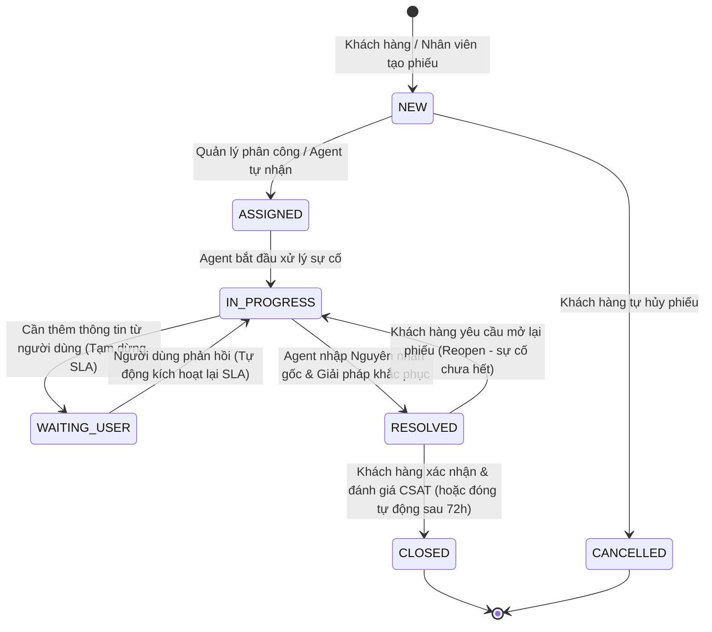

# Sơ Đồ Phân Rã Chức Năng Hệ Thống (Functional Decomposition Diagram - FDD)

> **Dự án:** HelpDesk Enterprise 2026 — Hệ thống Quản trị Yêu cầu Hỗ trợ & Xử lý Sự cố ITIL v4  
> **Tài liệu:** Thiết kế Kiến trúc Phân rã Chức năng (Functional Architecture Specification)  
> **Phiên bản:** 2.0.0 (Cập nhật chuẩn hóa quy trình doanh nghiệp)  

---

## 1. Biểu Đồ Phân Rã Chức Năng Tổng Thể (Functional Decomposition Tree)

```mermaid
graph TD
    Root["HỆ THỐNG HELPDESK ENTERPRISE"]

    %% 4 Phân hệ cấp 1
    Root --> M1["1. PHÂN HỆ QUẢN TRỊ & HỆ THỐNG"]
    Root --> M2["2. PHÂN HỆ VẬN HÀNH & XỬ LÝ (ITSM)"]
    Root --> M3["3. PHÂN HỆ CỔNG TỰ PHỤC VỤ (PORTAL)"]
    Root --> M4["4. PHÂN HỆ GIÁM SÁT & BÁO CÁO (BI)"]

    %% Cấp 2 của Phân hệ 1
    M1 --> M1_1["1.1. Xác thực & Kiểm soát truy cập"]
    M1 --> M1_2["1.2. Quản lý Tổ chức & Người dùng"]
    M1 --> M1_3["1.3. Cấu hình Danh mục & Độ ưu tiên"]
    M1 --> M1_4["1.4. Thiết lập Chính sách SLA"]

    %% Cấp 3 của Phân hệ 1
    M1_1 --> M1_1_1["Đăng nhập / Đăng xuất JWT"]
    M1_1 --> M1_1_2["Phân quyền nghiêm ngặt 4 vai trò (RBAC)"]
    M1_1 --> M1_1_3["Kiểm soát phê duyệt đăng ký nội bộ"]
    M1_1 --> M1_1_4["Đổi mật khẩu & Thu hồi phiên"]

    M1_2 --> M1_2_1["Quản lý cơ cấu Phòng ban (Departments)"]
    M1_2 --> M1_2_2["Quản lý tài khoản (Admin, Manager, Agent, Customer)"]
    M1_2 --> M1_2_3["Hồ sơ kỹ thuật viên & năng lực (Skills/Capacity)"]
    M1_2 --> M1_2_4["Khóa / Mở khóa tài khoản nhân sự"]

    M1_3 --> M1_3_1["Phân loại danh mục sự cố đa cấp (Category)"]
    M1_3 --> M1_3_2["Gán phòng ban phụ trách mặc định"]
    M1_3 --> M1_3_3["Thiết lập 4 mức độ ưu tiên (Low, Med, High, Urgent)"]

    M1_4 --> M1_4_1["Ma trận SLA phản hồi (MTTA) theo độ ưu tiên"]
    M1_4 --> M1_4_2["Ma trận SLA xử lý (MTTR) theo độ ưu tiên"]
    M1_4 --> M1_4_3["Quy tắc tự động leo thang vi phạm (Escalation)"]

    %% Cấp 2 của Phân hệ 2
    M2 --> M2_1["2.1. Tiếp nhận & Điều phối Phiếu"]
    M2 --> M2_2["2.2. Xử lý Kỹ thuật & Vòng đời Ticket"]
    M2 --> M2_3["2.3. Tương tác & Ghi nhận Sự cố"]

    %% Cấp 3 của Phân hệ 2
    M2_1 --> M2_1_1["Tạo phiếu hỗ trợ nội bộ"]
    M2_1 --> M2_1_2["Tự động sinh mã chuẩn TK-YYYYMMDD-XXXX"]
    M2_1 --> M2_1_3["Điều phối thủ công & Phân công tự nhận (Claim)"]
    M2_1 --> M2_1_4["Cân bằng tải công việc kỹ thuật viên"]

    M2_2 --> M2_2_1["Luồng chuyển trạng thái 6 bước ITIL"]
    M2_2 --> M2_2_2["Cơ chế tạm dừng SLA (Waiting for User)"]
    M2_2 --> M2_2_3["Tự động kích hoạt lại SLA khi khách hàng phản hồi"]
    M2_2 --> M2_2_4["Bắt buộc ghi nhận Nguyên nhân gốc & Giải pháp"]

    M2_3 --> M2_3_1["Trao đổi bình luận công khai"]
    M2_3 --> M2_3_2["Ghi chú nội bộ bảo mật (Internal Notes)"]
    M2_3 --> M2_3_3["Đính kèm tệp tin tài liệu & hình ảnh"]
    M2_3 --> M2_3_4["Nhật ký kiểm toán biến động (Audit Trail)"]

    %% Cấp 2 của Phân hệ 3
    M3 --> M3_1["3.1. Cổng Khách Hàng (Customer Portal)"]
    M3 --> M3_2["3.2. Quản lý Yêu Cầu Cá Nhân"]
    M3 --> M3_3["3.3. Cơ Sở Tri Thức Tự Phục Vụ (KB)"]

    %% Cấp 3 của Phân hệ 3
    M3_1 --> M3_1_1["Bảng điều khiển tổng quan cá nhân"]
    M3_1 --> M3_1_2["Form gửi yêu cầu hỗ trợ trực quan"]
    M3_1 --> M3_1_3["Khảo sát hài lòng CSAT 1-5 sao khi hoàn tất"]

    M3_2 --> M3_2_1["Cách ly dữ liệu nghiêm ngặt (Chỉ xem phiếu của mình)"]
    M3_2 --> M3_2_2["Theo dõi tiến độ xử lý và hạn chót SLA"]
    M3_2 --> M3_2_3["Yêu cầu mở lại phiếu (Reopen) nếu sự cố tái diễn"]
    M3_2 --> M3_2_4["Hủy yêu cầu hỗ trợ khi phiếu ở trạng thái New"]

    M3_3 --> M3_3_1["Tìm kiếm bài viết hướng dẫn xử lý nhanh (FAQ)"]
    M3_3 --> M3_3_2["Phân loại cẩm nang theo danh mục kỹ thuật"]
    M3_3 --> M3_3_3["Đánh giá độ hữu ích của bài viết (Helpful/Unhelpful)"]

    %% Cấp 2 của Phân hệ 4
    M4 --> M4_1["4.1. Bảng Thông Tin Trực Quan (Dashboard)"]
    M4 --> M4_2["4.2. Báo Cáo Đo Lường Hiệu Suất (KPI)"]
    M4 --> M4_3["4.3. Giám Sát SLA & Cảnh Báo Vi Phạm"]

    %% Cấp 3 của Phân hệ 4
    M4_1 --> M4_1_1["Chỉ số tổng hợp theo thời gian thực"]
    M4_1 --> M4_1_2["Biểu đồ phân bổ trạng thái và phòng ban"]
    M4_1 --> M4_1_3["Danh sách cảnh báo sự cố khẩn cấp"]

    M4_2 --> M4_2_1["Báo cáo năng suất kỹ thuật viên (Agent Performance)"]
    M4_2 --> M4_2_2["Báo cáo tỷ lệ hài lòng dịch vụ (CSAT Index)"]
    M4_2 --> M4_2_3["Xuất báo cáo định dạng Excel / PDF"]

    M4_3 --> M4_3_1["Bộ đếm ngược thời gian SLA Response & Resolve"]
    M4_3 --> M4_3_2["Phát hiện và đánh dấu phiếu vi phạm (Breached)"]
    M4_3 --> M4_3_3["Cơ chế leo thang thông báo lên Quản lý"]
```

---

## 2. Ma Trận Phân Quyền Chức Năng Theo Tác Nhân (Actor-Feature Matrix)

| Nhóm chức năng | Chức năng chi tiết | Khách hàng (CUSTOMER) | Kỹ thuật viên (AGENT) | Trưởng bộ phận (MANAGER) | Quản trị viên (ADMIN) |
|:---|:---|:---:|:---:|:---:|:---:|
| **1. Quản trị & Xác thực** | Đăng nhập, đổi mật khẩu cá nhân | Có | Có | Có | Có |
| | Đăng ký tài khoản (chờ duyệt) | Có | - | - | - |
| | Quản lý người dùng & Duyệt tài khoản | - | - | Có (trong PB) | Toàn quyền |
| | Quản lý cơ cấu phòng ban | - | - | Xem | Toàn quyền |
| | Cấu hình Danh mục, Ưu tiên, SLA | - | - | Đề xuất | Toàn quyền |
| **2. Quản lý Phiếu (ITSM)** | Tạo phiếu yêu cầu hỗ trợ | Có (Portal) | Có (Staff) | Có (Staff) | Có (Staff) |
| | Xem danh sách phiếu | Phiếu của mình | Phiếu phòng ban | Toàn phòng ban | Toàn hệ thống |
| | Phân công / Nhận xử lý phiếu | - | Tự nhận (Claim) | Phân công nhân sự | Điều phối toàn cục |
| | Cập nhật tiến độ & Chuyển trạng thái | Hủy/Đóng/Mở lại | Chuyển luồng ITIL | Phê duyệt/Chuyển luồng | Can thiệp tối cao |
| | Ghi nhận nguyên nhân & Giải pháp | - | Bắt buộc | Kiểm duyệt | Xem/Sửa |
| | Bình luận công khai | Có | Có | Có | Có |
| | Ghi chú nội bộ (Internal Notes) | - | Có | Có | Có |
| **3. CSAT & Đóng phiếu** | Chấm điểm CSAT 1-5 sao kèm phản hồi | Có | - | - | - |
| | Yêu cầu mở lại phiếu (Reopen) | Có | - | - | - |
| **4. Cẩm nang tri thức (KB)**| Tra cứu FAQ, bài viết tự khắc phục | Xem & Đánh giá | Xem & Soạn thảo | Duyệt bài | Toàn quyền |
| **5. Báo cáo & Giám sát** | Theo dõi đồng hồ đếm ngược SLA | Xem của mình | Xem phiếu gán | Xem của đội ngũ | Toàn hệ thống |
| | Bảng biểu Dashboard & Thống kê | - | Cá nhân | Phòng ban | Toàn doanh nghiệp |
| | Xuất dữ liệu báo cáo Excel/PDF | - | - | Có | Có |

---

## 3. Kiến Trúc Luồng Vòng Đời Phiếu Hỗ Trợ (ITIL Ticket Lifecycle)

---

## 4. Danh Mục 16 Yêu Cầu Chức Năng (Đối Soát Chi Tiết Báo Cáo)

1. **FR01: Đăng ký & Xác thực Tài khoản**: Đăng ký có kiểm soát xét duyệt, đăng nhập phân quyền bảo mật JWT.
2. **FR02: Tạo Phiếu Yêu Cầu**: Hỗ trợ đính kèm tệp tin, chọn danh mục, phân loại mức độ khẩn cấp.
3. **FR03: Hủy Phiếu Yêu Cầu**: Người dùng hủy phiếu khi sự cố tự khắc phục hoặc không còn nhu cầu.
4. **FR04: Đóng Phiếu & Đánh Giá CSAT**: Khách hàng chấm điểm 1-5 sao và để lại nhận xét chất lượng phục vụ.
5. **FR05: Mở Lại Phiếu Hỗ Trợ (Reopen)**: Người dùng mở lại phiếu khi sự cố phát sinh lại sau khi xử lý.
6. **FR06: Tiếp Nhận & Tự Phân Công (Claim)**: Kỹ thuật viên chủ động nhận việc theo năng lực.
7. **FR07: Phân Công Phiếu Thủ Công**: Quản lý gán kỹ thuật viên phù hợp trực tiếp cho từng sự cố.
8. **FR08: Cập Nhật Trạng Thái Xử Lý**: Tiến trình chuẩn hóa theo luồng trạng thái ITIL.
9. **FR09: Tạm Dừng & Tiếp Tục SLA**: Tạm dừng đồng hồ tính hạn khi chờ người dùng phản hồi.
10. **FR10: Trao Đổi & Ghi Chú Kỹ Thuật**: Bình luận công khai với khách hàng và ghi chú nội bộ giữa kỹ thuật viên.
11. **FR11: Ghi Nhận Giải Pháp & Đóng Sự Cố**: Bắt buộc nhập nguyên nhân gốc và phương án khắc phục trước khi Resolve.
12. **FR12: Quản Lý Cơ Cấu Tổ Chức & Người Dùng**: Quản trị tài khoản, phân quyền, phòng ban.
13. **FR13: Quản Lý Danh Mục Sự Cố & Độ Ưu Tiên**: Phân loại chuẩn hóa cây danh mục sự cố doanh nghiệp.
14. **FR14: Thiết Lập Chính Sách Cam Kết SLA**: Ma trận giờ phản hồi (MTTA) và giờ giải quyết (MTTR).
15. **FR15: Giám Sát Vi Phạm & Leo Thang Tự Động**: Cảnh báo sớm nguy cơ trễ hạn và kích hoạt báo động lên cấp quản lý.
16. **FR16: Cơ Sở Tri Thức & Báo Cáo Thống Kê**: Thư viện bài viết FAQ và Dashboard chỉ số vận hành.
